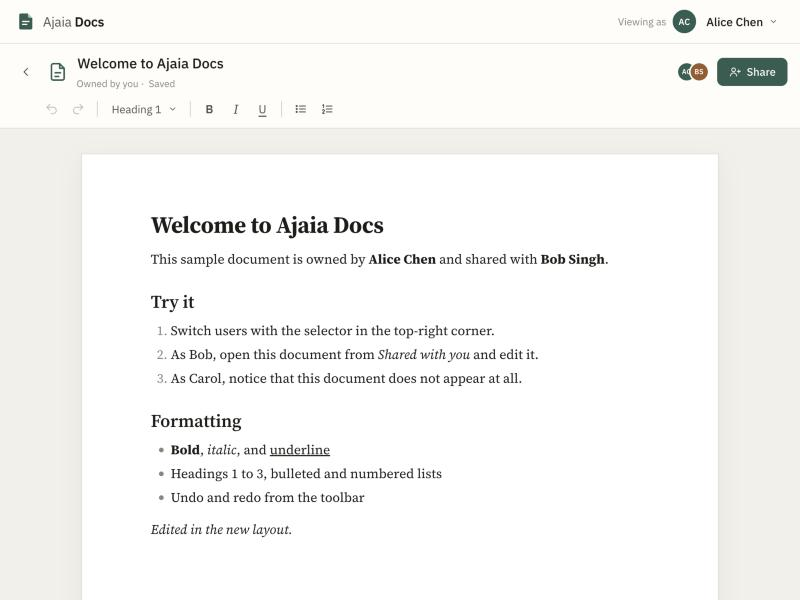
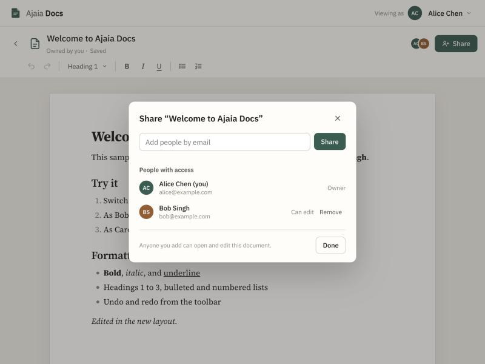

# Ajaia Docs

A small collaborative document editor, loosely modelled on Google Docs. You can create and rename documents, write with basic formatting, import `.txt` / `.md` / `.docx` files, and share a document with a teammate. Everything is still there after a refresh or a server restart.

I kept the scope deliberately small. `ARCHITECTURE.md` covers what I built, what I cut, and why.

**Live demo:** https://ajaia-docs-wsm4.onrender.com (test accounts are in `SUBMISSION.md`)





## Requirements

- Node.js **22.13 or newer**. The app uses Node's built-in `node:sqlite` module, so there is no native build step and no database server to install.
- npm

## Set up and run locally

```bash
npm install
npm start            # builds the client, then serves http://localhost:3000
```

`npm start` runs `npm run build` first. The build uses esbuild to bundle `client/app.js` (and the TipTap editor) into `public/dist/app.js`. It takes under a second.

On first start the server creates `data/ajaia.db` and seeds one sample document. Alice owns it and it is shared with Bob, so you can try sharing right away.

Optional environment variables:

| Variable    | Default         | Purpose                                                   |
|-------------|-----------------|-----------------------------------------------------------|
| `PORT`      | `3000`          | HTTP port                                                 |
| `DB_PATH`   | `data/ajaia.db` | SQLite file, created on first run                         |
| `SEED_DEMO` | on              | Set to `false` to skip the sample document on an empty DB |

To reset all data, stop the server and delete `data/`.

## Run the tests

```bash
npm test
```

There are 24 Vitest tests. They start the real Express app on a random port with an in-memory database and call it over HTTP. They cover:

- create, rename, edit, and reopen
- HTML sanitization, including a round trip of the exact markup the editor produces
- access control and sharing (owner only, 404 for non-members, revoke)
- `.txt`, `.md`, and real `.docx` import, plus unsupported, oversized, and corrupt files
- malformed requests
- persistence after the database file is closed and reopened
- the demo seed

## Using the app

1. **Pick a user.** The **Viewing as** selector in the top right switches between three seeded accounts: **Alice Chen**, **Bob Singh**, and **Carol Diaz**. It stands in for login, which the brief allows. It is not secure.
2. **Create or import.** Click **New document**, or **Import file** to turn a file into a new document.
3. **Edit.** Type on the page. Edits autosave 0.8 s after you stop typing. The status under the title shows *Unsaved changes → Saving… → Saved*. Press **Ctrl/Cmd+S**, or click the status, to save immediately. If a save fails, the status turns red and says *Couldn't save · Retry*. If you close the tab with unsaved edits, the browser warns you first.
4. **Format.** Use the toolbar or the shortcuts for undo/redo, body text and Heading 1–3, bold (Ctrl+B), italic (Ctrl+I), underline (Ctrl+U), and bulleted and numbered lists. Toolbar buttons highlight when the formatting is active at the cursor.
5. **Rename.** Click the title and edit it. It saves when you press Enter or click away, and Escape cancels.
6. **Share.** If you own the document, click **Share**, enter a seeded user's email (the field suggests `bob@example.com` and `carol@example.com`), and click **Share**. The dialog lists everyone with access. That person can then open and edit the document, and you can click **Remove** to take their access away at any time. The avatars next to the Share button show who has access.
7. **Owned vs shared.** The documents page has two sections, **My documents** and **Shared with me**, with an Owner column showing *me* or the owner's name. In the editor, owners see *Owned by you* and a Share button. People it was shared with see *Alice Chen shared this with you* and a *Shared by Alice Chen* label, with no Share button.

### Suggested review path (2 minutes)

1. As **Alice**, open *Welcome to Ajaia Docs*, add some formatting, and refresh. The formatting is still there.
2. Switch to **Bob**. The document is under *Shared with me*. Open it and edit it.
3. Switch to **Carol**. She can't see it, and pasting its URL shows *Can't open this document*.
4. As anyone, click **Import file** and pick a file from `samples/`.

## File upload

Supported types are **`.txt`, `.md`, and `.docx`, up to 2 MB**. The documents page says this right under the heading. Each import becomes a new editable document named after the file.

| Type    | What is kept                                                                                   |
|---------|------------------------------------------------------------------------------------------------|
| `.txt`  | Blank lines become paragraphs, and single newlines become line breaks                          |
| `.md`   | `#`/`##`/`###` headings, `-`/`*` bullets, `1.` numbered lists, `**bold**`, `*italic*`. Other Markdown stays as plain text |
| `.docx` | Converted with Mammoth: headings, paragraphs, bold, italic, and lists. Images and complex layout are dropped |

Other file types, files over 2 MB, and damaged `.docx` files get a clear error message. Sample files to try are in `samples/`.

## Deployment

`render.yaml` is a Render Blueprint for a single **free** web service, so reviewers don't pay for anything:

1. Push this repository to GitHub.
2. In Render, choose **New → Blueprint** and select the repository.
3. Render runs `npm ci && npm run build`, then `node src/server.js`, and checks health at `/api/health`.

Render's free disk is temporary. Data survives refreshes and normal use, but it is wiped when the service redeploys or spins down after about 15 idle minutes. When that happens the server re-seeds the sample document on boot, so the demo is never empty. For storage that lasts, attach a Render disk and point `DB_PATH` at it. See `ARCHITECTURE.md` for more.

## Project layout

```
client/app.js        browser app: routing, documents page, TipTap editor, share dialog
public/              index.html, styles.css, and the built bundle in public/dist/ (generated)
src/
  server.js          entry point (PORT, DB_PATH, demo seed)
  app.js             Express routes, access checks, upload handling, sanitization
  store.js           all SQL, in one place
  db.js              schema and seeded users
  seed.js            sample document for empty databases
  convert.js         text and Markdown to HTML
tests/               Vitest API tests and a .docx fixture
samples/             files to try with Import
docs/screenshots/    screenshots of the main flows
render.yaml          deployment blueprint
```

## API

Every route except `/api/health` and `/api/users` needs an `x-user-id` header containing a seeded user id.

| Method | Path                                | Purpose                                          |
|--------|-------------------------------------|--------------------------------------------------|
| GET    | `/api/users`                        | List seeded users                                |
| GET    | `/api/documents`                    | Documents the caller owns or has been shared     |
| POST   | `/api/documents`                    | Create a document                                |
| GET    | `/api/documents/:id`                | Read a document (owners also get the share list) |
| PATCH  | `/api/documents/:id`                | Rename and/or save content                       |
| POST   | `/api/documents/:id/shares`         | Share with `{ email }` (owner only)              |
| DELETE | `/api/documents/:id/shares/:userId` | Remove access (owner only)                       |
| POST   | `/api/documents/import`             | Multipart upload, field `file`                   |

## Troubleshooting

- **`Port 3000 is already in use`**: another copy of the app is still running. Stop it with `lsof -ti tcp:3000 | xargs kill`, or run on another port with `PORT=3001 npm start`.
- **`ExperimentalWarning: SQLite is an experimental feature`**: expected. Node's built-in SQLite module is still flagged experimental. It's harmless.
- **Old UI after pulling changes**: hard-refresh (Cmd/Ctrl+Shift+R). The client bundle is rebuilt on every `npm start`.

## Known limitations

- Identity is a seeded-user switcher, not authentication.
- Saving is last-write-wins. There is no real-time co-editing, so two people editing at the same moment can overwrite each other.
- Sharing always grants edit access. There is no view-only role and no share link.
- Documents can't be deleted, and there is no version history or comments.
